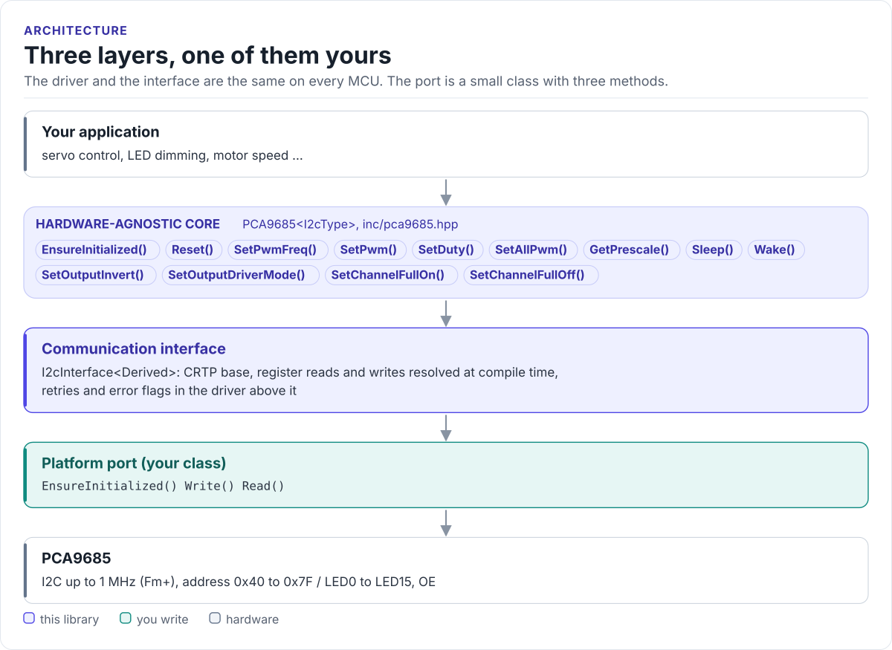

# PCA9685 Driver

A C++20 driver for the NXP PCA9685 16-channel, 12-bit PWM controller: set the frequency, drive servos, LEDs and
motor drivers by duty cycle or by tick, from any MCU with I2C.

[](https://github.com/hardfoc/hf-pca9685-driver/actions/workflows/ci-host-tests.yml)
[](https://github.com/hardfoc/hf-pca9685-driver/actions/workflows/esp32-examples-build-ci.yml)
[](https://hardfoc.github.io/hf-pca9685-driver/)
[](LICENSE)

**Documentation: <https://hardfoc.github.io/hf-pca9685-driver/>**

<!-- figure: driver-layers -->
<picture>
  <source media="(prefers-color-scheme: dark)" srcset="docs/diagrams/driver-layers.dark.svg">
  
</picture>
<!-- /figure -->

## In 30 seconds

Write a small port class for your MCU (bus init, register write, register read;
[Porting](https://hardfoc.github.io/hf-pca9685-driver/latest/porting/)), then:

<!-- generated: quickstart-code -->
```cpp
#include "pca9685.hpp"

int center_servo_on_channel_0(MyI2c& bus) {
  pca9685::PCA9685<MyI2c> pwm(&bus, 0x40);        // A0..A5 tied low

  if (!pwm.EnsureInitialized()) {                 // 1. bus up, MODE1 reset
    return -1;                                    // wiring, pull-ups or address
  }
  if (!pwm.SetPwmFreq(50.0f)) {                   // 2. 50 Hz: a 20 ms servo frame
    return -2;
  }
  // 3. 1.5 ms high out of 20 ms = 7.5 % duty: servo centre
  if (!pwm.SetDuty(0, 1.5f / 20.0f)) {
    return -3;
  }
  return 0;
}
```
<!-- /generated -->

## What it does

- Sets the PWM frequency in hertz (24 Hz to 1526 Hz), running the sleep / PRE_SCALE / wake sequence the chip
  needs.
- Drives each of the 16 channels by duty cycle (`SetDuty()`), by ON and OFF tick with a phase offset
  (`SetPwm()`), fully on or fully off, or all at once (`SetAllPwm()`).
- Configures the output stage (totem pole or open drain, inversion) and puts the chip to sleep and back.
- Reports failures as `bool` results and a bitmask of error flags, with configurable I2C retries.
- No heap, no exceptions, no RTOS, no virtual calls (the port is a CRTP class).

## Install

```bash
git submodule add https://github.com/hardfoc/hf-pca9685-driver.git external/hf-pca9685-driver
```

```cmake
add_subdirectory(external/hf-pca9685-driver)
target_link_libraries(my_app PRIVATE hf::pca9685)
```

ESP-IDF: use the component wrapper in [`examples/esp32/components/hf_pca9685`](examples/esp32/components/hf_pca9685/CMakeLists.txt).
Details: [Installation](https://hardfoc.github.io/hf-pca9685-driver/latest/installation/).

## Documentation

| | |
| --- | --- |
| [Quickstart](https://hardfoc.github.io/hf-pca9685-driver/latest/quickstart/) | Wire it, write the port, centre a servo |
| [Hardware](https://hardfoc.github.io/hf-pca9685-driver/latest/hardware/) | Pins, addresses, bus settings, output stage, power |
| [PWM timing](https://hardfoc.github.io/hf-pca9685-driver/latest/pwm-timing/) | The counter, ON and OFF ticks, the prescaler, servo pulses |
| [API guide](https://hardfoc.github.io/hf-pca9685-driver/latest/api-guide/) | Initialise, set the frequency, drive outputs, handle errors |
| [Examples](https://hardfoc.github.io/hf-pca9685-driver/latest/examples/) | ESP32-S3 test suite and servo demo |
| [API reference](https://hardfoc.github.io/hf-pca9685-driver/latest/api/) | Doxygen, every class and member |

The pages are in [`docs/`](docs/index.md); the datasheet is in [`docs/datasheet/`](docs/datasheet/PCA9685.pdf).

## Tests

```bash
cmake -S . -B build-host -DHF_PCA9685_BUILD_TESTS=ON && cmake --build build-host && ctest --test-dir build-host
```

The host tests run the driver against a model of the chip's registers; the code on the documentation site is
compiled by the same build.

## License

GPL-3.0. See [LICENSE](LICENSE).
