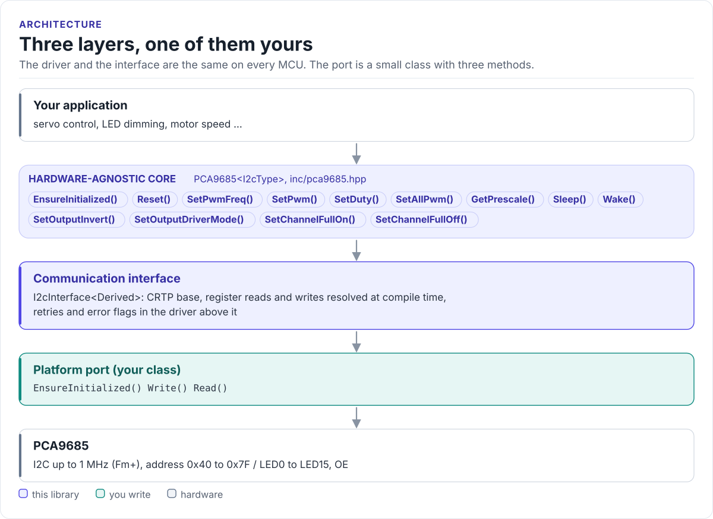
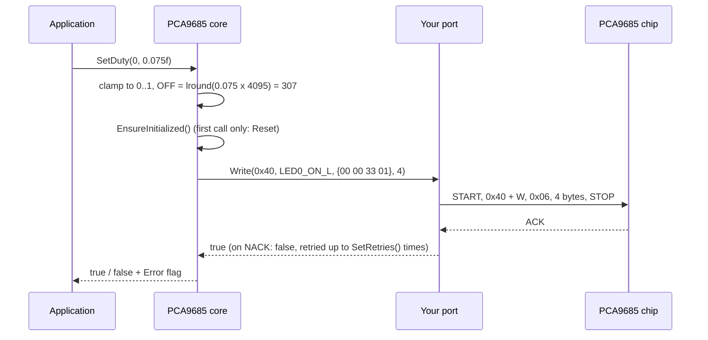

# Architecture

How the driver is put together: three layers, what each owns, and how one call reaches the chip.

<!-- figure: driver-layers -->
<picture>
  <source media="(prefers-color-scheme: dark)" srcset="diagrams/driver-layers.dark.svg">
  
</picture>
<!-- /figure -->

## The three layers

| Layer | Where | You change it when |
| --- | --- | --- |
| **Hardware-agnostic core**: `PCA9685<I2cType>` | [`inc/pca9685.hpp`](../inc/pca9685.hpp), [`src/pca9685.ipp`](../src/pca9685.ipp) | Never, for a new board |
| **Communication interface**: `I2cInterface<Derived>` | [`inc/pca9685_i2c_interface.hpp`](../inc/pca9685_i2c_interface.hpp) | Never |
| **Platform port**: your class, three methods | Your project | Once per MCU or board ([Porting](porting.md)) |

Everything above the port is the same on ESP32, STM32, a Linux host or the unit-test model. That is how the
[host tests](testing.md) run the real driver code without hardware.

## How one call reaches the chip

## Why CRTP

The interface is a class template parameter, not a virtual base class. The compiler sees your port's methods
directly and inlines them; the driver has no vtable, allocates nothing and needs no RTTI. The cost is that the
driver type names the port: `PCA9685<MyI2c>`. Code that has to work with several port types takes the driver as
a template parameter too.

## Lazy initialisation

The constructor only stores the bus pointer and the address; it never touches the bus. The first call that needs
the chip runs `EnsureInitialized()`, which calls the port's `EnsureInitialized()` and then `Reset()` (MODE1 =
`0x00`). After that, `IsInitialized()` is `true` and no call repeats it. Call `EnsureInitialized()` yourself at
start-up to find wiring problems early, at a point where you can report them.

## Errors without exceptions

Each call returns `bool`. On `false`, the reason is in two places:

- `GetErrorFlags()`: a bitmask of `Error` values that accumulates until you clear it with `ClearErrorFlags()` or
  `ClearError()`.
- `GetLastError()`: the most recent error; a later successful call sets it back to `Error::None`.

Register accesses retry: one attempt plus `SetRetries()` more (3 by default), with an optional callback between
attempts (`SetRetryDelay()`).

## Source map

| Path | Contents |
| --- | --- |
| `inc/pca9685.hpp` | `PCA9685<I2cType>`: registers, error flags, the public API |
| `src/pca9685.ipp` | Template implementation, included by the header |
| `inc/pca9685_i2c_interface.hpp` | `I2cInterface<Derived>`, `CtrlPin`, `GpioSignal` |
| `inc/pca9685_version.h.in` | Version header template, filled in by CMake |
| `tests/` | Host unit tests and the compiled documentation snippets |
| `examples/esp32/` | ESP-IDF applications and the ESP-IDF port |
