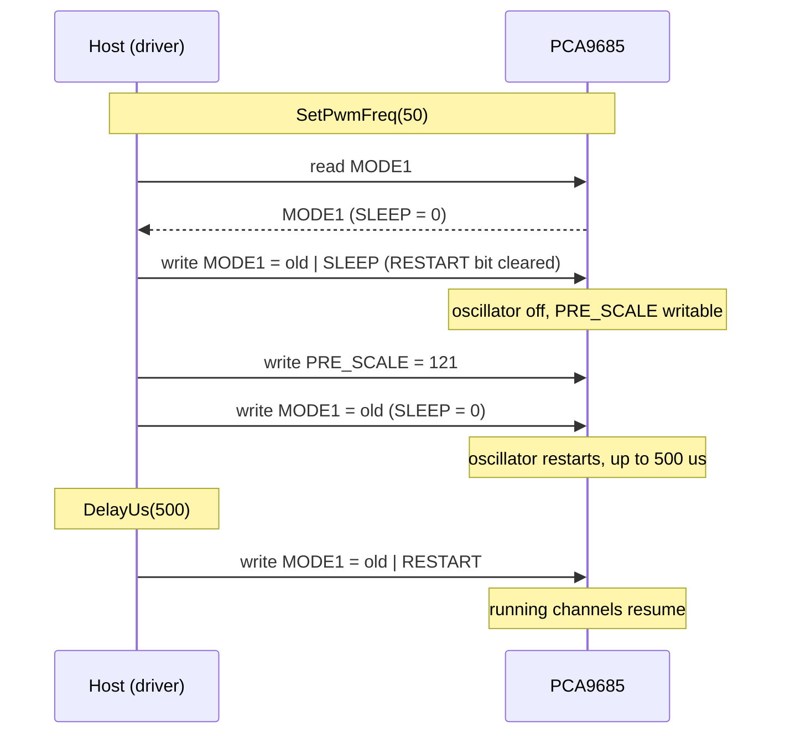

# Hardware

What to connect between your MCU and a PCA9685, with which bus settings, and the board-level traps to avoid.

All values here come from the [PCA9685 datasheet](datasheet/PCA9685.pdf) (Rev. 4, 16 April 2015); page numbers
refer to it. Pin numbers are for the TSSOP28 package. When they disagree with a breakout board's schematic, the
schematic wins.

{ .hf-plate }

## Pins

| Pin | Signal | Function |
| --- | --- | --- |
| 26 | SCL | In: I2C clock; pull-up to VDD |
| 27 | SDA | In/out: I2C data; pull-up to VDD |
| 1-5, 24 | A0-A5 | In: address bits; no pull-ups, tie each high or low |
| 23 | OE | In: output enable, active low; no pull-up |
| 25 | EXTCLK | In: external clock up to 50 MHz; ground it when unused |
| 6-13 | LED0-LED7 | Out: PWM outputs |
| 15-22 | LED8-LED15 | Out: PWM outputs |
| 28 | VDD | Supply, 2.3 V to 5.5 V |
| 14 | VSS | Ground |

??? note "HVQFN28 pin numbers"
    SCL 23, SDA 24, A0 to A4 26, 27, 28, 1, 2, A5 21, OE 20, EXTCLK 22, LED0 to LED7 3 to 10, LED8 to LED15
    12 to 19, VDD 25, VSS 11. The exposed pad is also ground and must be soldered.

Source: Table 3, p. 6.

## Address

The 7-bit address is `1 A5 A4 A3 A2 A1 A0` (Figure 4, p. 8): `0x40` with every address pin low, up to `0x7F`
with every pin high. Pass it to the constructor: `PCA9685<MyI2c> pwm(&bus, 0x41)`.

| Address | Use it? | Why |
| --- | --- | --- |
| `0x40` to `0x6F` | Yes | Regular addresses |
| `0x70` | No | LED All Call address, enabled at power-up: every PCA9685 on the bus answers it |
| `0x71` to `0x77` | With care | `0x71`, `0x72` and `0x74` are the Sub Call defaults (disabled at power-up) |
| `0x78` to `0x7F` | No, on a shared bus | Reserved by the I2C specification (10-bit addressing, future use) |

The datasheet counts 62 usable addresses (section 7.1, p. 7). The general-call Software Reset (`0x00`, data byte
`0x06`) resets every PCA9685 on the bus; the driver does not send it.

## Bus settings

| Setting | Value | Source |
| --- | --- | --- |
| Speed | Standard mode 100 kHz, Fast mode 400 kHz, Fast-mode Plus 1 MHz | Table 15, p. 40 |
| Write | START, address + W, register, data bytes, STOP | Figure 20, p. 32 |
| Read | START, address + W, register, repeated START, address + R, data, STOP | Figure 22, p. 33 |
| Multi-byte access | The register pointer advances only when MODE1.AI = 1 | Table 5, p. 14 |
| Output update | On STOP (default, MODE2.OCH = 0) or on ACK | Table 6, p. 16 |
| Bus time-out | The interface resets if SCL or SDA is held low for at least 25 ms | Table 15, note 1 |
| SDA drive | 30 mA sink, for buses up to 4000 pF | Sections 1 and 2, pp. 1-2 |

The driver writes a channel as one four-byte transaction starting at `LEDn_ON_L` and reads single registers.
Your port turns each call into exactly one transaction ([Porting](porting.md)).

## Output stage

The 16 outputs share one configuration in MODE2 (Table 6, p. 16).

| MODE2 bit | Default | Effect | Driver call |
| --- | --- | --- | --- |
| `OUTDRV` (bit 2) | 1: totem pole | 0: open drain | `SetOutputDriverMode(bool totem_pole)` |
| `INVRT` (bit 4) | 0: not inverted | 1: outputs inverted while OE is low | `SetOutputInvert(bool invert)` |
| `OCH` (bit 3) | 0: change on STOP | 1: change on ACK | none |
| `OUTNE[1:0]` (bits 1:0) | 00: LEDn = 0 while OE is high | 01: 1 (totem pole) or high-Z; 1x: high-Z | none |

Totem pole sinks 25 mA and sources 10 mA at 5 V; open drain sinks 25 mA. LEDs with built-in Zener diodes must be
driven in open-drain mode (Table 6, note 1). For a servo signal or a logic-level gate driver input use totem
pole, `INVRT = 0`.

OE is active low. Low: outputs follow their registers. High: outputs take the OUTNE state, by default low. The
driver does not drive OE; tie it low or control it from a GPIO yourself.

## Power

| Parameter | Min | Typ | Max | Unit | Source |
| --- | --- | --- | --- | --- | --- |
| Supply voltage VDD | 2.3 | | 5.5 | V | Table 14, p. 38 |
| Supply current, operating, no load, fSCL = 1 MHz | | 6 | 10 | mA | Table 14 |
| Standby current (SLEEP, fSCL = 0) | | 2.2 | 15.5 | µA | Table 14 |
| Power-on reset threshold VPOR | | 1.70 | 2.0 | V | Table 14 |
| Output current per LEDn pin | | | 25 | mA | Table 13, p. 38 |
| Total ground current ISS | | | 400 | mA | Table 13 |
| Operating temperature | −40 | | +85 | °C | Table 13 |

To repeat a power-on reset, VDD must fall below 0.2 V (section 7.5, p. 27). Place a 100 nF capacitor between VDD
and VSS close to the chip. Loads (servos, LED strings, motors) take their own supply; only the signal and the
ground are shared with the PCA9685.

## Timing that affects the host

| Event | Time | Driver behaviour |
| --- | --- | --- |
| Oscillator start after MODE1.SLEEP is cleared | 500 µs max | `Reset()`, `Wake()` and `SetPwmFreq()` wait 500 µs before they return (Table 5, note 2) |
| SLEEP low before writing RESTART | 500 µs min | `Wake()` and `SetPwmFreq()` write RESTART only after the 500 µs wait (section 7.3.1.1, p. 15) |
| OE to output | 40 ns to 60 ns | n/a (Table 15) |

## Breakout boards

The [ESP32 examples](examples.md) run on an ESP32-S3 with a PCA9685 at `0x40`: SDA on GPIO4, SCL on GPIO5,
100 kHz, OE not driven. The pins are in
[`esp32_pca9685_test_config.hpp`](../examples/esp32/main/esp32_pca9685_test_config.hpp). Common 16-channel servo
breakouts fit the I2C pull-ups, a pull-down on OE and solder jumpers for A0 to A5; check the board's schematic.

## Reference documents

| Document | What it is for |
| --- | --- |
| [PCA9685 datasheet](datasheet/PCA9685.pdf) | Pins, registers, I2C protocol, electrical limits |
| [NXP PCA9685 product page](https://www.nxp.com/products/PCA9685) | Latest datasheet revision, application notes |
