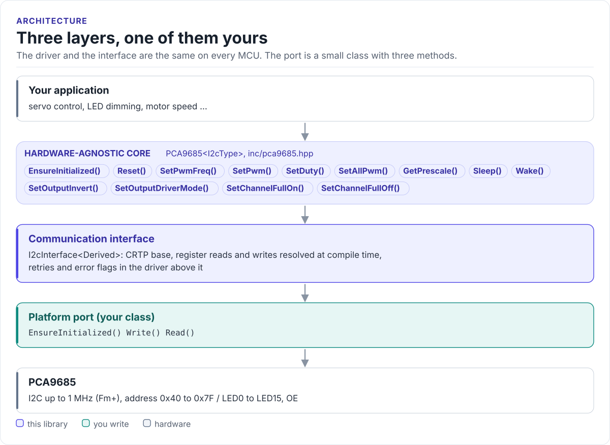

# Porting

Run the driver on a new MCU by writing one class: the I2C interface.

The driver never calls your SDK directly. It calls three methods on a class you derive from
`pca9685::I2cInterface<Self>` (in [`inc/pca9685_i2c_interface.hpp`](../inc/pca9685_i2c_interface.hpp)). The
base class uses CRTP: the calls are resolved at compile time, so there are no virtual functions, no vtable and
nothing to allocate.

<!-- figure: driver-layers -->
<picture>
  <source media="(prefers-color-scheme: dark)" srcset="diagrams/driver-layers.dark.svg">
  
</picture>
<!-- /figure -->

## What you implement

| Method | Contract |
| --- | --- |
| `EnsureInitialized()` | Bring the bus up on the first call; return `true` at once afterwards. `false` stops the driver from starting |
| `Write(addr, reg, data, len)` | One transaction: START, `addr` + W, `reg`, `len` bytes, STOP. `true` only if every byte was acknowledged |
| `Read(addr, reg, data, len)` | One transaction: START, `addr` + W, `reg`, repeated START, `addr` + R, `len` bytes, STOP |
| `DelayUs(us)` | Optional, recommended: wait at least `us` microseconds. The driver calls it with 500 after it clears MODE1.SLEEP, for the oscillator start-up time (datasheet Table 5, note 2) |
| `GpioSet(pin, signal)` | Optional: drive the OE pin; called by `SetOutputEnable()` (see below) |

`addr` is the 7-bit address; shift it left yourself if your SDK wants the 8-bit form. The driver writes at most
four data bytes per call and reads one.

The optional methods are found at compile time: a port without them still builds. Without `DelayUs()` the driver
covers the 500 µs start-up with 13 one-byte reads of MODE1, enough at any bus clock up to 1 MHz, so give your port
a `DelayUs()` if its `Read()` can return without running a bus transaction.

## I2C port

```cpp title="my_i2c.hpp"
--8<-- "tests/docs/my_i2c.hpp:port"
```

Rules the transfer must follow:

- **One call, one transaction.** Never split a channel's four bytes into separate transactions: the chip
  updates the outputs at the STOP, and the register pointer does not carry over.
- **Repeated START for reads.** Write the register byte, then read without a STOP in between (Figure 22 of the
  datasheet).
- **Return `false` for a NACK or a bus error.** The driver retries and sets the error flags; do not retry in the
  port as well.
- **Bounded time-outs.** A stuck bus should fail the call, not block forever. The chip resets its own interface
  when SCL or SDA stays low for 25 ms.
- **Clock up to 1 MHz.** Start at 100 kHz for bring-up; 400 kHz suits most boards.

## The OE pin

OE is active low (datasheet section 7.4): low, the outputs follow their registers; high, they take the
MODE2.OUTNE state, low by default. If OE is wired to a GPIO, declare `GpioSet()` in your port and map
`GpioSignal::ACTIVE` (outputs enabled) to a low level:

```cpp
--8<-- "tests/docs/ports.cpp:oe-port"
```

`SetOutputEnable(true)` calls `GpioSet(CtrlPin::OE, GpioSignal::ACTIVE)` and `SetOutputEnable(false)` calls it
with `INACTIVE`; the base class helpers `GpioSetActive()` and `GpioSetInactive()` reach your `GpioSet()` too. A
port without `GpioSet()` inherits a do-nothing default, for boards with OE tied low. The driver never drives OE
on its own, so your port can hold the outputs blanked from power-up until the channels are programmed.

## Reference implementation

The ESP32 examples use [`esp32_pca9685_bus.hpp`](../examples/esp32/main/esp32_pca9685_bus.hpp): an ESP-IDF
`i2c_master` port that caches the device handle, with a `RetryDelay()` (`vTaskDelay` of 1 ms) that you pass to
`SetRetryDelay()`. Start from it for any ESP-IDF target.

## Check your port

1. Build it: the port on this page is compiled by the host CI from [`tests/docs/`](../tests/docs/my_i2c.hpp),
   with the driver instantiated over it.
2. Call `EnsureInitialized()`: `true` proves a write to MODE1 was acknowledged at your address.
3. Call `SetPwmFreq(50.0f)`, then `GetPrescale()`: 121 proves reads and writes both work.
4. Put a scope or logic analyser on LED0 after `SetDuty(0, 0.5f)`: a 50 % square wave at about 50 Hz.

## Threads

The driver is not thread-safe. Give each PCA9685 one owner task, or guard every call on a driver object with one
mutex. Several chips on one bus share the port, so guard the port too.
